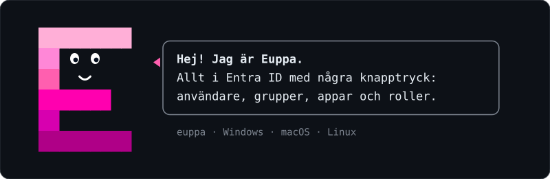

# Euppa

<p align="center">
  
</p>

Allt du behöver göra i **Entra ID**, med några knapptryck i stället för att leta i portalen eller skriva Graph-anrop.
Fungerar likadant på **Windows, macOS och Linux**. Kusin till [Uppa](https://github.com/pipebreak33/uppa),
[Puppa](https://github.com/pipebreak33/puppa) och [Muppa](https://github.com/pipebreak33/muppa), och finns som egen
sida i [Ruppa](https://github.com/pipebreak33/ruppa). Maskoten är ett E med ögon: den föreslår nästa steg, blinkar och
tittar runt medan något körs, blir glad när det gick bra och orolig innan något ändras.

## Installera (eller uppdatera – kör samma rad igen)

**Windows** (PowerShell):

```powershell
irm https://raw.githubusercontent.com/pipebreak33/euppa/main/install.ps1 | iex
```

**macOS / Linux:**

```bash
curl -fsSL https://raw.githubusercontent.com/pipebreak33/euppa/main/install.sh | sh
```

Installern hittar (eller på Windows installerar) Python 3.8+, lägger Euppa i `~/.euppa/app` och skapar kommandot
`euppa` (`~/.local/bin/euppa`, eller `%USERPROFILE%\.euppa\bin\euppa.cmd` + PATH på Windows). Dina tenants och
inställningar i `~/.euppa` rörs aldrig vid uppdatering. Den varnar om PowerShell 7 eller modulen saknas.
Med [Wuppa](https://github.com/pipebreak33/wuppa) eller [Ruppa](https://github.com/pipebreak33/ruppa) kommer Euppa
med automatiskt.

Styr källan med `EUPPA_REPO=ägare/repo` och `EUPPA_BRANCH=gren`. Från en lokal kopia: `./install.sh` / `./install.ps1`.

Kräver PowerShell 7 (`pwsh`) och **bara en modul**: `Microsoft.Graph.Authentication`. Allt går via
`Invoke-MgGraphRequest` mot Microsoft Graph, så inga av de tunga Graph-undermodulerna behövs.
`ImportExcel` behövs bara för Excel-export (annars blir det CSV).


## Avinstallera

**Windows** (PowerShell):

```powershell
irm https://raw.githubusercontent.com/pipebreak33/euppa/main/uninstall.ps1 | iex
```

**macOS / Linux:**

```bash
curl -fsSL https://raw.githubusercontent.com/pipebreak33/euppa/main/uninstall.sh | sh
```

Tar bort programmet och kommandot `euppa` (och PATH-posten på Windows). Det behåller dina tenants och inställningar i `~/.euppa`, och rapporterna i `~/Documents/Euppa`.
`EUPPA_PURGE=1` tar bort även dina data, och `EUPPA_YES=1` hoppar över frågan.

## Så funkar det

- **Användare först.** *Användare…* listar alla i tenanten. Skriv för att fuzzy-söka, kryssa en eller flera med
  mellanslag (`ctrl+a` kryssar alla som syns) och välj vad som ska hända: lägg till i grupp, ta bort ur grupp,
  tilldela licens, spärra, återställ lösenord eller MFA, ge en roll … Allt körs på en gång och bekräftas en gång.
- **Områden.** 83 åtgärder i 11 områden: användare, gäster, grupper, enheter, appar, roller och
  PIM, villkorlig åtkomst, loggar, säkerhet och tenanten. Börja skriva i vilken meny som helst så söker du bland allt.
- **Sök i tenanten.** När en åtgärd frågar efter användare, grupp, enhet, app, roll, policy eller licens räcker en del
  av namnet. En träff väljs direkt, flera ger en lista (kryssrutor när flera kan väljas).
- **Rätt scopes per uppgift.** Euppa loggar in med `Connect-MgGraph` och just de scopes som åtgärden behöver, och
  lägger till fler när det behövs utan att tappa de gamla. *Logga in…* ger läsbehörighet för nästan allt på en gång.
- **Tenants som i Puppa.** Inloggningen sparar tenanten (domän, id, konto) i *Tenants…*, så du kan växla mellan
  kunder. Första gången lånar Euppa Puppas lista. Välj **webbläsare** eller **enhetskod** (bra över SSH) per tenant.
- **Läsande först, ändringar med ja.** Läsåtgärder körs direkt. Åtgärder märkta **ändrar** visar hela kommandot och
  vilken tenant det gäller, och kräver ett **j** (eller `--ja` i CLI). `-n` visar bara vad som skulle köras.
- **Excel eller CSV.** Efter en läsåtgärd: `x` för Excel, `c` för CSV, i `~/Documents/Euppa`.
- **Ingen nyckelringsfråga.** På macOS sparas inloggningen som standard bara under körningen (`-ContextScope
  Process`). Slå på *Kom ihåg inloggningar* (eller `euppa kom-ihåg på`) för att slippa logga in varje gång.

## Kommandon

| | |
|---|---|
| `euppa` | menyn |
| `euppa användare [UPN …]` | välj användare (flerval) och gör något med dem |
| `euppa åtgärder [--json]` | alla åtgärder per område (`--json`: områden, åtgärder och fält för Ruppa) |
| `euppa kör ÅTGÄRD [Namn=värde …]` | kör en åtgärd; frågar efter det som saknas |
| `  --ja` | bekräfta ändrande åtgärder utan att fråga (krävs utan terminal) |
| `  --excel` / `--csv` / `--json` | spara resultatet i `~/Documents/Euppa`, eller skriv ut det som JSON |
| `euppa uppslag TYP [sök] [--alla] [--json]` | sök i tenanten: `user`, `group`, `device`, `app`, `sp`, `role`, `ca`, `sku`, `deleted` |
| `euppa logga-in [--scopes A,B] [--enhetskod] [--tenant X]` | logga in i Microsoft Graph |
| `euppa tenants` / `euppa tenant NAMN` / `euppa ny` | sparade tenants, växla, lägg till |
| `euppa kom-ihåg på\|av` | spara inloggningar mellan körningar |
| `euppa logga-ut` | `Disconnect-MgGraph` |
| `-n`, `--torr` | visa kommandona utan att köra något |
| `--no-anim` | inga animationer (stängs också av av `NO_COLOR` och när utdata pipas) |

Flera värden skrivs kommaseparerat. Exempel:

```bash
euppa kör grupper-lagg-till Anvandare=anna@contoso.se,bo@contoso.se Grupp=Säljare --ja
euppa kör appar-hemligheter-gar-ut Dagar=60 --excel
euppa kör ca-lage Policy="Kräv MFA för admins" Lage=Report-only --ja
euppa uppslag user --alla --json
```

## Vad Euppa kan

### Användare

| Åtgärd | | Vad den gör |
|---|---|---|
| `anvandare-lista` | läs | **Lista användare.** Alla användare med status, typ, titel, avdelning och antal licenser. |
| `anvandare-info` | läs | **Användarinfo.** Allt om en eller flera användare: kontakt, chef, status, synk, licenser, grupper och senaste inloggning. |
| `anvandare-inaktiva` | läs | **Inaktiva användare.** Konton som inte loggat in på X dagar (eller aldrig). Kräver Entra ID P1 för inloggningsdatum. |
| `anvandare-skapa` | ändrar | **Skapa användare.** Ny molnanvändare. Lämnar du lösenordet tomt hittar Euppa på ett starkt och visar det en gång. |
| `anvandare-andra` | ändrar | **Ändra fält på användare.** Sätt titel, avdelning, kontor, mobil, företag m.m. på en eller flera användare. Tomt värde rensar fältet. |
| `anvandare-sparra` | ändrar | **Spärra och logga ut.** Stänger av inloggningen och återkallar alla sessioner (token) direkt. Ditt eget konto hoppas över. |
| `anvandare-aktivera` | ändrar | **Aktivera konto.** Slår på inloggningen igen för spärrade konton. |
| `anvandare-losenord` | ändrar | **Återställ lösenord.** Nytt lösenord för en eller flera användare. Tomt = ett unikt, starkt lösenord per person som visas en gång. |
| `anvandare-logga-ut` | ändrar | **Logga ut överallt.** Återkallar alla sessioner och uppdateringstoken. Användaren måste logga in igen på alla enheter. |
| `anvandare-mfa` | läs | **MFA-metoder.** Vilka inloggningsmetoder användarna har registrerat: Authenticator, telefon, FIDO2-nyckel, Windows Hello … |
| `anvandare-mfa-aterstall` | ändrar | **Återställ MFA.** Tar bort alla registrerade MFA-metoder (lösenordet behålls) och loggar ut. Användaren registrerar sig igen vid nästa inloggning. |
| `anvandare-tap` | ändrar | **Tillfälligt lösenord (TAP).** Skapar ett Temporary Access Pass, t.ex. för att registrera MFA eller en ny dator. Kräver att TAP är påslaget i tenanten. |
| `anvandare-licenser` | läs | **Användarens licenser.** Licenser per användare och om de är direkt tilldelade eller kommer via en grupp. |
| `anvandare-licens-tilldela` | ändrar | **Tilldela licens.** Ger användarna en licens. Saknar någon användningsplats sätts den först (krävs för licenser). |
| `anvandare-licens-ta-bort` | ändrar | **Ta bort licens.** Tar bort en direkt tilldelad licens. Licenser som kommer via grupp tas bort genom att ta bort användaren ur gruppen. |
| `anvandare-chef` | ändrar | **Sätt chef.** Sätter chefen (manager) för en eller flera användare. |
| `anvandare-grupper` | läs | **Användarens grupper och roller.** Grupper, adminroller och administrativa enheter som användarna är direkt medlemmar i. |
| `anvandare-enheter` | läs | **Användarens enheter.** Enheter som användarna äger eller har registrerat. |
| `anvandare-ta-bort` | ändrar | **Ta bort användare.** Raderar användarna. De ligger kvar under Raderade användare i 30 dagar och kan återställas. Ditt eget konto hoppas över. |
| `anvandare-raderade` | läs | **Raderade användare.** Användare i papperskorgen och hur många dagar som är kvar innan de försvinner för gott. |
| `anvandare-aterstall` | ändrar | **Återställ raderad användare.** Tar tillbaka raderade användare med licenser och gruppmedlemskap. |

### Gäster

| Åtgärd | | Vad den gör |
|---|---|---|
| `gaster-lista` | läs | **Lista gäster.** Alla gästkonton: inbjudan accepterad eller inte, när de bjöds in och senaste inloggning. |
| `gaster-ej-accepterade` | läs | **Gäster som inte accepterat.** Inbjudningar som legat oaccepterade längre än X dagar – bra att städa bort. |
| `gaster-bjud-in` | ändrar | **Bjud in gäst.** Bjuder in en eller flera externa (kommaseparerade e-postadresser) och visar inlösningslänken. |

### Grupper

| Åtgärd | | Vad den gör |
|---|---|---|
| `grupper-lista` | läs | **Lista grupper.** Alla grupper med typ (Microsoft 365, säkerhet, distribution), dynamiskt eller tilldelat medlemskap och e-post. |
| `grupper-medlemmar` | läs | **Gruppmedlemmar.** Vilka som är med i gruppen – direkt, eller även via undergrupper. |
| `grupper-agare` | läs | **Gruppens ägare.** Ägarna till en eller flera grupper. |
| `grupper-utan-agare` | läs | **Grupper utan ägare.** Grupper som ingen äger – vanligt städobjekt. |
| `grupper-dynamiska` | läs | **Dynamiska grupper.** Grupper med dynamiskt medlemskap, deras regel och om regeln är på eller pausad. |
| `grupper-skapa` | ändrar | **Skapa grupp.** Ny säkerhetsgrupp eller Microsoft 365-grupp, med ägare och medlemmar direkt. |
| `grupper-lagg-till` | ändrar | **Lägg till i grupp.** Lägger till användarna som medlemmar i en eller flera grupper. Redan medlem räknas som klart. |
| `grupper-ta-bort` | ändrar | **Ta bort ur grupp.** Tar bort användarna ur en eller flera grupper. |
| `grupper-agare-lagg-till` | ändrar | **Lägg till ägare.** Gör användarna till ägare av en eller flera grupper. |
| `grupper-agare-ta-bort` | ändrar | **Ta bort ägare.** Tar bort användarna som ägare. En grupp måste ha minst en ägare kvar om den har ägare. |
| `grupper-dynamisk-regel` | ändrar | **Sätt dynamisk regel.** Gör gruppen dynamisk med en regel, t.ex. (user.department -eq "Sälj"). Tilldelade medlemmar ersätts av regeln. |
| `grupper-radera` | ändrar | **Radera grupp.** Raderar grupperna. Microsoft 365-grupper kan återställas i 30 dagar, säkerhetsgrupper inte. |

### Enheter

| Åtgärd | | Vad den gör |
|---|---|---|
| `enheter-lista` | läs | **Lista enheter.** Alla enheter i Entra ID: OS, anslutning (Entra-ansluten, hybrid, registrerad), status och senaste inloggning. |
| `enheter-inaktiva` | läs | **Inaktiva enheter.** Enheter som inte loggat in på X dagar – kandidater att inaktivera och sedan ta bort. |
| `enheter-inaktivera` | ändrar | **Inaktivera enhet.** Stänger av enheterna i Entra ID (de kan inte logga in), utan att ta bort dem. |
| `enheter-aktivera` | ändrar | **Aktivera enhet.** Slår på inaktiverade enheter igen. |
| `enheter-ta-bort` | ändrar | **Ta bort enhet.** Raderar enheterna ur Entra ID. BitLocker-nycklar och LAPS-lösenord försvinner med dem – läs ut dem först. |
| `enheter-bitlocker` | läs | **BitLocker-nycklar.** Återställningsnycklar för enheterna. Varje uppslag loggas i granskningsloggen. |
| `enheter-laps` | läs | **LAPS-lösenord.** Det lokala adminlösenordet (Windows LAPS i Entra ID) för enheterna. Varje uppslag loggas. |

### Appar

| Åtgärd | | Vad den gör |
|---|---|---|
| `appar-lista` | läs | **Appregistreringar.** Alla appregistreringar med antal hemligheter och certifikat och när första går ut. |
| `appar-hemligheter-gar-ut` | läs | **Hemligheter och certifikat som går ut.** Klienthemligheter och certifikat (även SAML-signering på företagsappar) som går ut inom X dagar eller redan gått ut. |
| `appar-behorigheter` | läs | **Appens behörigheter.** API-behörigheter appen begär, delegerade och programbehörigheter, och om de har samtycke. |
| `appar-hemlighet-ny` | ändrar | **Ny klienthemlighet.** Skapar en ny hemlighet på appen. Värdet visas bara den här gången – kopiera det direkt. |
| `appar-hemligheter-rensa` | ändrar | **Ta bort utgångna hemligheter.** Rensar bort klienthemligheter som redan gått ut från apparna. |
| `foretagsappar-lista` | läs | **Företagsappar.** Företagsappar (enterprise applications): på/av, om tilldelning krävs, och om appen är egen eller extern. |
| `foretagsappar-samtycken` | läs | **Samtycken (delegerade).** Vilka appar som fått delegerade behörigheter, av admin för alla eller av enskilda användare. |
| `foretagsappar-anvandare` | läs | **Vem har åtkomst till appen.** Användare, grupper och appar som är tilldelade företagsappen, med roll. |
| `foretagsappar-samtycke` | ändrar | **Bevilja adminsamtycke.** Ger samtycke för hela organisationen till alla behörigheter appen begär (som knappen i portalen). |
| `foretagsappar-aterkalla` | ändrar | **Återkalla samtycke.** Tar bort alla samtycken (delegerade och/eller programbehörigheter) som företagsappen har fått. |
| `foretagsappar-av-pa` | ändrar | **Stäng av eller slå på företagsapp.** Av = ingen kan logga in i appen (bra vid misstänkt app). På = tillbaka igen. |

### Roller och PIM

| Åtgärd | | Vad den gör |
|---|---|---|
| `roller-lista` | läs | **Vem har adminroller.** Alla aktiva rolltilldelningar: roll, vem och omfattning. |
| `roller-anvandarens` | läs | **Användarens roller.** Aktiva och berättigade (PIM) roller för användarna. |
| `pim-berattigade` | läs | **Berättigade roller (PIM).** Alla som kan aktivera en roll i PIM, och hur länge de får. Kräver Entra ID P2. |
| `pim-aktiva` | läs | **Aktiva PIM-tilldelningar.** Roller som är aktiva just nu – permanenta och aktiverade via PIM – med sluttid. Kräver Entra ID P2. |
| `roller-tilldela` | ändrar | **Tilldela roll.** Ger användarna en adminroll – helst som berättigad i PIM (aktiveras vid behov) i stället för permanent. |
| `roller-ta-bort` | ändrar | **Ta bort roll.** Tar bort rollen från användarna – både aktiva och berättigade (PIM) tilldelningar. |
| `pim-aktivera` | ändrar | **Aktivera min roll (PIM).** Aktiverar en roll du är berättigad till, i några timmar. Kräver ofta MFA och motivering. |

### Villkorlig åtkomst

| Åtgärd | | Vad den gör |
|---|---|---|
| `ca-lista` | läs | **Policyer för villkorlig åtkomst.** Alla policyer: på, av eller report-only, vem och vilka appar de gäller och vad de kräver. |
| `ca-detalj` | läs | **Policy i klartext.** En policy uppdelad i vem, appar, villkor och krav – med namn i stället för id:n. |
| `ca-lage` | ändrar | **Byt läge på policy.** Sätt policyer i report-only (loggar vad som skulle hänt), på eller av. |
| `ca-undanta` | ändrar | **Undanta användare från policy.** Lägger till användare som undantag i policyer, t.ex. break-glass-konton. |
| `ca-platser` | läs | **Namngivna platser.** IP-intervall och länder som används i policyerna, och vilka som är betrodda. |
| `ca-plats-ny` | ändrar | **Ny namngiven plats.** Skapar en plats av IP-intervall (CIDR, t.ex. 203.0.113.0/24) eller länder (SE, NO …). |

### Loggar

| Åtgärd | | Vad den gör |
|---|---|---|
| `loggar-inloggningar` | läs | **Inloggningar.** Inloggningsloggen: vem, app, IP, plats, resultat och villkorlig åtkomst. Kräver Entra ID P1 (max 999 rader). |
| `loggar-misslyckade` | läs | **Misslyckade inloggningar per användare.** Sammanställning: vem som misslyckats, hur många gånger, med vilket fel och från hur många IP. |
| `loggar-granskning` | läs | **Granskningslogg.** Vem ändrade vad i katalogen: användare, grupper, roller, appar, policyer (max 999 rader). |

### Säkerhet

| Åtgärd | | Vad den gör |
|---|---|---|
| `risk-anvandare` | läs | **Riskanvändare.** Användare som Entra ID Protection flaggat som riskabla. Kräver Entra ID P2. |
| `risk-handelser` | läs | **Riskhändelser.** Upptäckta risker: okänd plats, läckta lösenord, omöjlig resa m.m. Kräver Entra ID P2. |
| `risk-avfarda` | ändrar | **Avfärda användarrisk.** Markerar risken som hanterad (t.ex. efter lösenordsbyte). |
| `risk-komprometterad` | ändrar | **Bekräfta komprometterad.** Sätter användarrisken till hög (bekräftat komprometterad), så att riskpolicyer slår till. Spärra kontot också. |
| `mfa-status` | läs | **MFA-status i tenanten.** Vilka som har MFA registrerat, med vilka metoder, och om de är admins. Kräver Entra ID P1. |

### Tenant

| Åtgärd | | Vad den gör |
|---|---|---|
| `tenant-licenser` | läs | **Licensöversikt.** Alla licenser: köpta, använda, lediga och status. |
| `tenant-licens-anvandare` | läs | **Vilka har licensen.** Alla användare med en viss licens, och om den är direkt eller via grupp. |
| `tenant-domaner` | läs | **Domäner.** Domänerna i tenanten: verifierade, standard, federerade och vad de används till. |
| `tenant-info` | läs | **Företagsinfo.** Namn, tenant-id, land, skapad, katalogsynk och om säkerhetsstandarder är på. |
| `tenant-installningar` | läs | **Företagsinställningar.** Vad användare får göra: registrera appar, skapa grupper och tenants, bjuda in gäster, samtycka till appar m.m. |
| `tenant-installning-andra` | ändrar | **Ändra företagsinställning.** Slå på eller av: appregistrering, grupp- och tenantskapande, gästinbjudningar, användarsamtycke, säkerhetsstandarder. |

### Lokalt

| Åtgärd | | Vad den gör |
|---|---|---|
| `lokalt-session` | lokal | **Min inloggning.** Vem du är inloggad som, i vilken tenant och med vilka scopes. |
| `lokalt-moduler` | lokal | **Moduler.** PowerShell och modulerna Euppa använder, med version. |

## Behörigheter och licenser

Euppa använder appen *Microsoft Graph Command Line Tools* med delegerade behörigheter: du kan aldrig göra mer än ditt
konto får. Första gången ett nytt scope behövs frågar Microsoft om samtycke (en Global Admin kan godkänna för
hela organisationen). Inloggnings- och granskningsloggar, MFA-status och villkorlig åtkomst kräver **Entra ID P1**;
riskanvändare, riskhändelser och PIM kräver **Entra ID P2**. Euppa säger till på svenska när något saknas.

## I Ruppa

[Ruppa](https://github.com/pipebreak33/ruppa) visar Euppa som en egen sida (⌘5) med områden, kort och formulär.
Ruppa är bara ett skal: den läser områden, åtgärder och fält ur den installerade `euppa.py` och kör
`euppa kör … --json`, `euppa uppslag … --json` och `euppa åtgärder --json`. Nya åtgärder i Euppa syns där direkt.

## Teknik

En Python-fil (bara standardbiblioteket, 3.8+) som håller en PowerShell 7-process öppen, så att Graph-inloggningen
lever mellan åtgärderna. Varje åtgärd är ett litet PowerShell-skript i `ACTIONS` i `euppa.py`, som pratar med Graph
via en tunn hjälpfunktion (`Graph 'users?$select=…' -All`) med sidhantering, felmeddelanden i klartext och uppslag
av namn till id. Data i `~/.euppa` (`kunder.json`, `config.json`) – inga hemligheter, inga token.

## Licens

MIT
